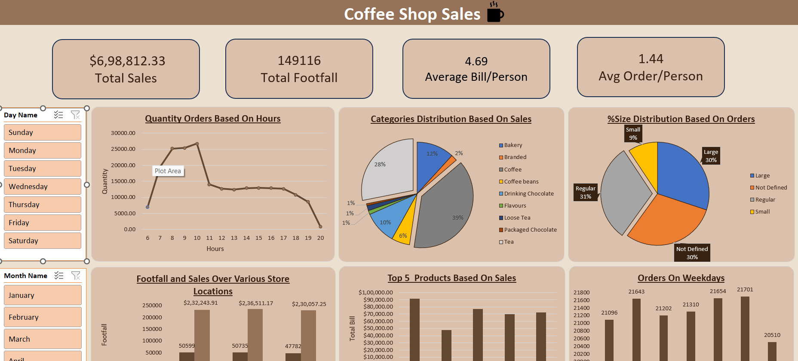

# Coffee-Shop-Sales-Dashboard

## About the Project

This project is based on Coffee Shop Sales Analysis using Microsoft Excel. The main goal was to analyze sales data and create an interactive dashboard to understand business performance and customer purchasing patterns.

As a Computer Science Engineering student exploring Data Analytics, this project helped me gain practical experience in data analysis and visualization.

## Project Objectives

- Analyze overall sales performance.
- Understand hourly sales and order trends.
- Identify the most popular product categories.
- Analyze customer preferences based on product size.
- Compare sales performance across different store locations.
- Identify the top 5 best-selling products.
- Understand weekday and monthly order patterns.

## Tools & Technologies

- Microsoft Excel
- Pivot Tables
- Pivot Charts
- Slicers
- Excel Formulas
- Data Visualization
  
## Dashboard Preview

☕ Coffee Shop Sales Analysis Dashboard

## Key Performance Indicators

| Metrics | Values |
|---|---|
| Total Sales | $698,812.33 |
| Total Footfall | 149,116 |
| Average Bill per Person | $4.69 |
| Average Orders per Person | 1.44 |
## Dashboard Insights

1. Quantity of Orders Based on Hours
2. Category Distribution Based on Sales
3. Size Distribution Based on Orders
4. Footfall and Sales Across Store Locations
5. Top 5 Products Based on Sales
6. Orders on Weekdays
7. Monthly and Daily Filtering

## What I Learned

- Working with sales datasets.
- Creating Pivot Tables and Pivot Charts.
- Using Slicers for interactive filtering.
- Building an interactive Excel dashboard.
- Presenting data through meaningful visualizations.

**Author:**

Ayantika Nath

Computer Science & Engineering Student

This project is part of my learning journey in Data Analytics.
